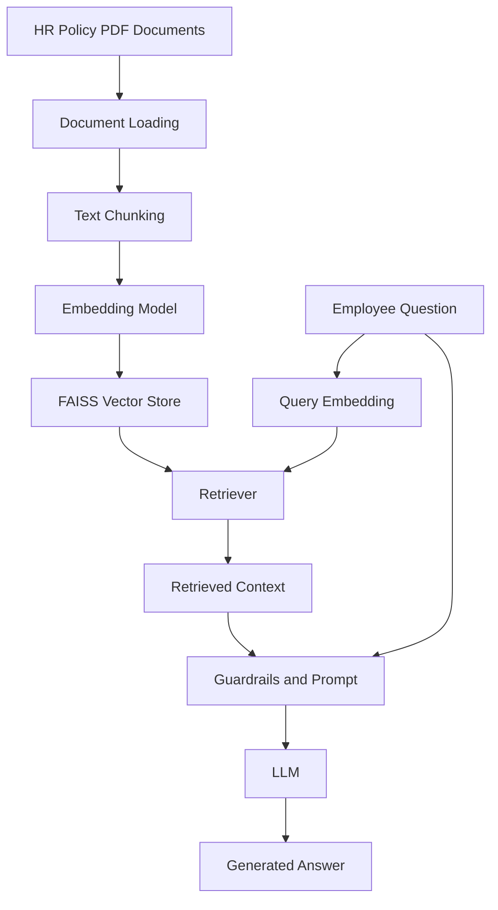

# Intelligent RAG — HR Policy Assistant

**An AI-powered Retrieval-Augmented Generation (RAG) system that answers employee questions using company HR policy documents.**

[GitHub Repository](https://github.com/rajamukhiya0501-crypto/Intelligent-RAG)

## Overview

Finding information in company HR documents can be time-consuming. Employees may need to search multiple policy PDFs to understand leave entitlements, maternity benefits, salary rules, and workplace guidelines.

Intelligent RAG addresses this problem by retrieving relevant information from HR documents and using a Large Language Model (LLM) to generate context-grounded answers.

The project was developed as part of a Generative AI learning project and Kaggle competition.

## Problem Statement

Build an intelligent HR assistant that can:

- Understand employee questions.
- Retrieve relevant information from internal HR policy documents.
- Generate accurate, context-aware responses.
- Handle questions that are outside the HR knowledge base.

## System Architecture



## Technology Stack

| Component | Technology |
|---|---|
| Programming Language | Python |
| LLM Framework | LangChain |
| Document Loading | PyPDFDirectoryLoader |
| Text Splitting | RecursiveCharacterTextSplitter |
| Embeddings | Sentence Transformers |
| Embedding Model | all-MiniLM-L6-v2 |
| Vector Search | FAISS |
| LLM Providers | Groq / Gemini / OpenAI (configurable in the project architecture) |
| Notebook | Jupyter / Kaggle |
| Data Processing | Pandas |
| Observability | LangSmith |

## How It Works

**1. Document Loading**

Loads HR policy PDFs and extracts their text and metadata.

**2. Text Chunking**

Splits large documents into smaller chunks so relevant information can be retrieved efficiently.

**3. Embedding Generation**

Converts text chunks into numerical vectors representing their semantic meaning.

**4. Vector Storage**

Stores embeddings in a FAISS index for similarity-based retrieval.

**5. Information Retrieval**

Finds the most relevant document chunks for an employee's question.

**6. Answer Generation**

Combines the retrieved context and question in a prompt and sends them to the configured LLM.

**7. Guardrails**

Helps handle questions outside the HR policy domain and limits unsupported answers.

## Project Workflow

```text
HR Documents
    ↓
Document Processing
    ↓
Chunking and Embeddings
    ↓
FAISS Index
    ↓
Question Retrieval
    ↓
LLM + Context
    ↓
Final Answer
    ↓
submission.csv
```

## Repository Structure

```text
Intelligent-RAG/
│
├── code.ipynb       # RAG pipeline implementation
├── README.md        # Project documentation
└── .gitignore       # Excluded files and secrets
```

Competition datasets, private HR documents, generated CSV files, and API credentials are intentionally excluded from the public repository.

## Getting Started

### 1. Clone the repository

```bash
git clone https://github.com/rajamukhiya0501-crypto/Intelligent-RAG.git
cd Intelligent-RAG
```

### 2. Set up Python

Use a compatible Python environment and install the dependencies required by the notebook.

### 3. Configure API credentials

Configure the API key for your selected LLM provider using the environment variable expected by the notebook.

**Never commit `.env` or expose API keys.**

### 4. Prepare the data

Provide the required HR policy PDF corpus and test questions in the expected directory structure.

For the Kaggle competition, attach the official competition dataset to the notebook.

### 5. Run the notebook

Open `code.ipynb` in Jupyter Notebook, VS Code, or Kaggle and execute the cells in order.

The pipeline processes the questions and generates answers in the required competition submission format.

## Key Learning Outcomes

- Understanding Retrieval-Augmented Generation.
- PDF document processing and text extraction.
- Text chunking and semantic embeddings.
- Vector databases and similarity search.
- Building retrieval pipelines using LangChain.
- Integrating Large Language Models.
- Prompt engineering and guardrails.
- Generating structured Kaggle submissions.

## Future Improvements

- Add a web-based chatbot interface.
- Display document citations with generated answers.
- Improve retrieval using hybrid search.
- Evaluate retrieval quality and answer accuracy.
- Add automated testing and error handling.

## Author

**Raja**

GitHub: [@rajamukhiya0501-crypto](https://github.com/rajamukhiya0501-crypto)

---

*Built while learning and exploring Generative AI, Large Language Models, and Retrieval-Augmented Generation.*


